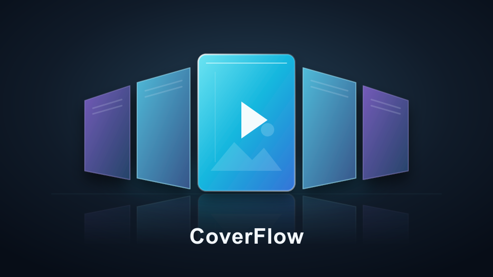

# CoverFlow for Jellyfin

**Rediscover your collection.**

Browse albums, movies, TV series, books and comics in a perspective CoverFlow
view. Turn a cover over to explore its content, without leaving your library.

[](https://github.com/lucalcin/jellyfin-coverflow/releases)
[](LICENSE)
[](https://github.com/lucalcin/jellyfin-coverflow/actions/workflows/checks.yml)



An independent, free and open-source extension for **Jellyfin Web**.
**Early preview:** feedback and device testing are welcome. It is not an
official Jellyfin plugin and does not add this interface to native TV clients.

[Download the preview](https://github.com/lucalcin/jellyfin-coverflow/releases)
· [Report a problem](https://github.com/lucalcin/jellyfin-coverflow/issues/new/choose)
· [Support development](https://ko-fi.com/effecta)

## What it does

- **A new view, not a new server.** Open CoverFlow from the library toolbar or
  the View menu; return to Grid or List at any time.
- **Flip to explore.** Square music albums reveal tracks; TV series show episodes
  grouped by season; books and movies show their descriptions.
- **Music sections with their own content.** Albums, album artists, artists,
  playlists, songs, genres and collections follow the selected Jellyfin section.
  Artist/genre cards reveal albums; playlist cards reveal tracks in playlist order.
  Each section keeps its own current selection. Suggestions retain Jellyfin's
  native recommendation sections rather than showing an unrelated album catalog.
- **Real comic folders.** Browse folders and subfolders, then their individual
  volumes. Existing folder structure is preserved, including duplicate names.
- **Your library, your order.** Follow Jellyfin's sort criterion and direction
  while keeping the same selected item. Each library remembers its view choice.
- **Mouse, keyboard and touch.** Click side covers, use arrow keys, wheel or swipe;
  hold an arrow to accelerate. A search field supports title-prefix navigation
  and opens the keyboard on mobile.
- **An A-Z/# side index.** Jump to the first matching initial without changing
  the current order. Accents are normalized; # covers numbers and other symbols.
- **The same item across views.** Keep the current item ID when switching
  between CoverFlow, Grid and List within the same library/folder, recovering
  its native page and highlighting it when necessary.
- **Progressive loading.** Show an initial catalog page, then load more in the
  background. Existing visible cover nodes are reused rather than recreated.
- **Jellyfin interface language.** Reuse native translations for common labels,
  counts, menus and accessibility. Language changes update labels in place;
  CoverFlow-specific messages use Italian/English local fallbacks.
- **Optional group posters.** Add `coverflow-series.png` or `coverflow-series.jpg`
  inside a comic/book folder; otherwise CoverFlow can use a descendant volume's
  cover. PNG takes precedence when both are present.

CoverFlow reads the existing catalog, metadata and images. It does not duplicate
your collection or rewrite media files, metadata or the Jellyfin database.

## Compatibility and requirements

| Component | Current preview |
| --- | --- |
| Jellyfin Server / Web | Targets 12.x; technical validation performed against 12.4.0 |
| JavaScript Injector | Required; the 4.x / Jellyfin 12-compatible build |
| Client | Jellyfin Web in a browser; other web-based clients are not guaranteed |
| Native TV / mobile clients | Not supported unless they actually load the compatible Web frontend |
| Interface language | Follows Jellyfin; reuses its native dictionaries. CoverFlow-specific messages support Italian and English (English fallback for other languages). |

Current user testing reports good results with movies, TV series, music and
comics. Ebooks still need validation. Personal photos and videos are experimental
and are not currently recommended as a demonstration of the plugin.

JavaScript Injector is a separate community dependency. CoverFlow registers its
script through that plugin; you do **not** need to paste JavaScript, fork
Jellyfin Web or manually edit its installed files.

The interface integrates with Web components and DOM structure rather than a
stable official view-extension API. Future Web updates can require adaptation.
The optional translation bridge recognizes the loaded native globalize module;
unrecognized frontend builds retain local Italian/English fallbacks. Media
titles and metadata keep the language already supplied by your library.
Jellyfin 10.x is not supported by this release.

## Install

Back up your Jellyfin configuration before installing third-party plugins.

### 1. Install JavaScript Injector

Follow the upstream
[JavaScript Injector installation instructions](https://github.com/n00bcodr/Jellyfin-JavaScript-Injector#-installation).
Its plugin repository is:

```text
https://raw.githubusercontent.com/n00bcodr/jellyfin-plugins/main/manifest.json
```

Choose the build compatible with Jellyfin 12 and restart Jellyfin as instructed.

### 2. Add the CoverFlow repository

In **Dashboard → Plugins → Repositories**, add a repository named **CoverFlow**:

```text
https://raw.githubusercontent.com/lucalcin/jellyfin-coverflow/main/manifest.json
```

Open the plugin catalog, install **CoverFlow**, then restart Jellyfin. Reload
Jellyfin Web in the browser after the server finishes starting.

The manifest URL is a plugin-catalog feed, not a website or a Jellyfin login.
Download URLs are versioned GitHub release assets; installation does not depend
on access to the maintainer's home media server.

### Manual alternative

Download `CoverFlow_0.4.9_Jellyfin12.zip` from
[Releases](https://github.com/lucalcin/jellyfin-coverflow/releases/tag/v0.4.9).
Stop Jellyfin and extract its three files into a dedicated plugin-version
directory such as `CoverFlow_0.4.9.0` under **your installation's plugin directory**:

```text
CoverFlow_0.4.9.0/
  Jellyfin.Plugin.CoverFlow.dll
  meta.json
  coverflow.png
```

Do not leave multiple CoverFlow DLL versions active. Move the previous version
outside the plugin directory so it can be restored, then start Jellyfin. The
JavaScript Injector dependency is still required. Plugin-directory paths vary
with the operating system and container configuration.

## Use CoverFlow

1. Open a library in Jellyfin Web and select **CoverFlow** in the View menu or
   click its perspective-cover toolbar icon.
2. Click a side cover to advance one position. Click the center cover to turn it
   over and reveal its contents.
3. Scroll the back independently. Use the curved arrow to return to the cover.
   On a folder's back, choose **Sfoglia in CoverFlow** to enter it.
4. Use the native Jellyfin sort menu to reorder both views. The selected item
   remains selected even when its new position requires loading another page.
5. Select Grid or List, or toggle the CoverFlow icon, to leave this view.

Choose the view once in each library. For example, TV series and comics can use
CoverFlow while photos use List and movies use Grid. CoverFlow respects those
independent choices when moving between libraries and returning to the same URL.
Jellyfin continues to own native Grid/List persistence. To recover the selected
item the extension may update the native page StartIndex and clear a conflicting
alphabet constraint; it preserves the current view, sort and unrelated filters.
Existing CoverFlow preferences are preserved.
Preferences are local to the browser, not synchronized between devices. Clearing
browser site data resets them; unavailable storage limits saving to the session.

The A-Z/# index follows `SortName` when available, otherwise the displayed title.
If the initial is not loaded yet, the jump waits for background pages. The
existing catalog-window limit still applies: disabled initials mean no matching
item in the loaded window, not necessarily none anywhere on the server.

The current item is the focused/clicked native card, or a visible card if none
was selected, and the center cover in CoverFlow. Switching views does not reset
it to the first item. Recovering a distant native page can require metadata
requests; a target already on the correct page can be restored immediately.
If filters exclude it, a notice is shown and its anchor is retained rather than
silently selecting another item. Anchors are session-local and folder-specific:
open the same folder in both interfaces; switching does not automatically
navigate the native client to a different folder.

The keyboard button opens a real title-search field. Enter hides the mobile
keyboard; a second click closes the field. Escape closes the card back first,
then goes up through folders or exits CoverFlow.

Track and episode rows, and **Apri in Jellyfin**, open the usual detail pages.
They do not automatically start playback. Album-artist sorting uses Jellyfin's
`AlbumArtist` metadata, not a composer stored only in the People field.

## Preview limitations

- Perceived fluidity on real phones, Safari and large libraries still needs
  community validation. Passing an automated test is not device UX acceptance.
- Initial catalog loading uses 80 items followed by pages of up to 500. The
  normal catalog window is 5,000 items, not full virtualized browsing. A reorder
  may scan farther to preserve the selected item.
- Card details load on demand in pages of 100; the metadata cache holds up to
  eight cards per library.
- Custom themes and Jellyfin Web changes may affect toolbar/menu integration.
- Posters depend on the metadata and local files available to the server.

If you find a problem, please include your plugin/Web/Server versions, device,
browser, library type and approximate size in a
[bug report](https://github.com/lucalcin/jellyfin-coverflow/issues/new/choose).
Remove tokens, API keys, personal server addresses and private paths from any
screenshots or logs. See [SECURITY.md](SECURITY.md) for sensitive reports.

## Build and test

Requires .NET SDK 10 and Node.js 22 or newer.

```bash
dotnet publish Jellyfin.Plugin.CoverFlow/Jellyfin.Plugin.CoverFlow.csproj \
  --configuration Release --output dist/publish
npm ci
npm test
```

The .NET build embeds the frontend JavaScript. Distribute only the plugin DLL,
the version's `meta.json` and `coverflow.png`; do not bundle Jellyfin runtime DLLs.
The build output alone does not install the plugin or restart your server.

For the isolated Chromium integration test:

```bash
npx playwright install chromium
npm run test:browser
```

`CHROMIUM_EXECUTABLE` can select an existing Chromium/Chrome binary. The optional
`JELLYFIN_WEB_ROOT` environment variable enables an additional test against an
extracted copy of the installed public Web bundles, including real React and
MUI MenuItem/MenuList components, SVG arrows and the useLocalStorage hook. For
the Jellyfin 12.4 test, include the `78701.*.chunk.js` and
`node_modules.usehooks-ts.*.chunk.js` dependencies as well as the vendor bundles.
No credentials or live library are required.

See [CONTRIBUTING.md](CONTRIBUTING.md) and [CHANGELOG.md](CHANGELOG.md).

## Support the project

If CoverFlow makes your collection more enjoyable, you can buy me a coffee to
support its development. Support is entirely optional: the plugin stays free
and open source, with no paid feature tier.

[](https://ko-fi.com/effecta)

**https://ko-fi.com/effecta**

## License and acknowledgments

Copyright (C) 2026 Effecta. Licensed under **GPL-3.0-or-later**; see
[LICENSE](LICENSE) and [NOTICE.md](NOTICE.md).

Built for [Jellyfin](https://jellyfin.org/) and delivered through
[JavaScript Injector](https://github.com/n00bcodr/Jellyfin-JavaScript-Injector).
Those projects are independent of CoverFlow and are not responsible for its
support. No Jellyfin or Apple affiliation or endorsement is implied.
